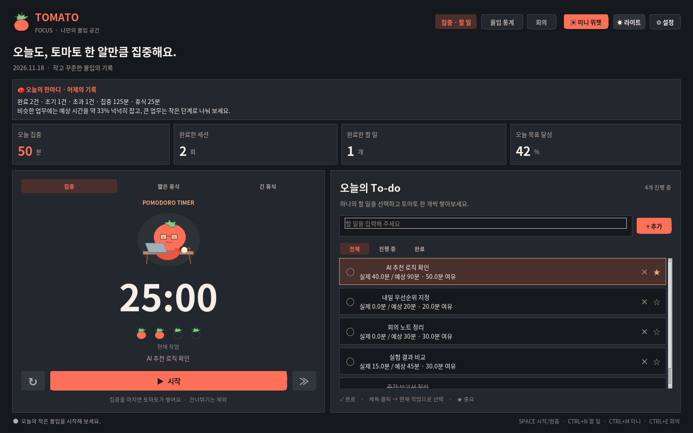
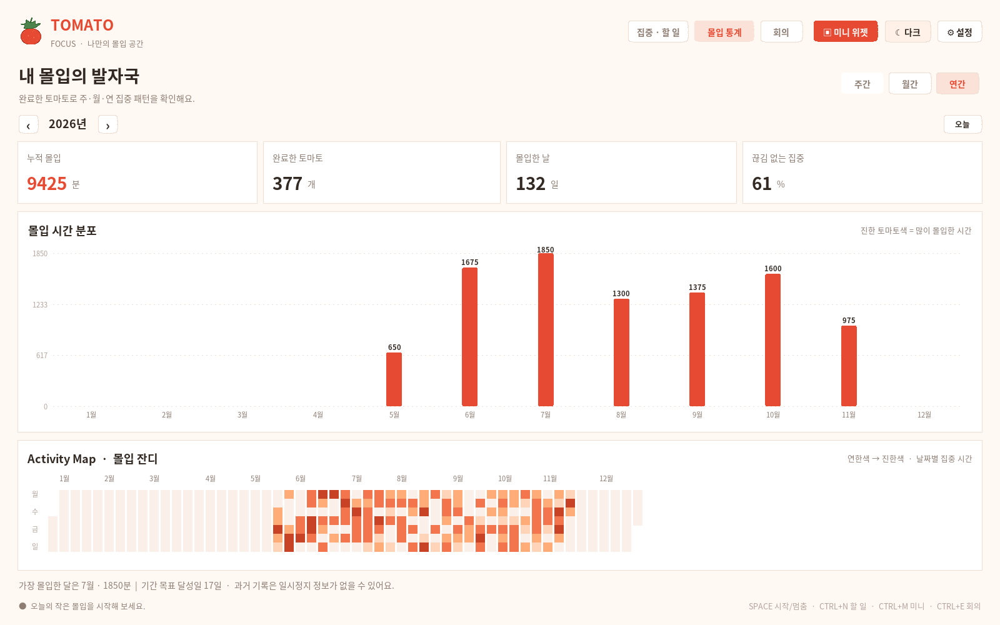

# Pomodoro_Timer_Python

<div align="center">

# 🍅 Tomato Focus

**오늘도, 토마토 한 알만큼 집중해요\.**

Tkinter로 만든 가벼운 데스크톱 뽀모도로 타이머
집중 시간 관리 · To\-do · 주/월/연 몰입 통계 · 항상 위에 표시되는 미니 위젯

**Python 3\.9\+** · **Tkinter** · **Windows EXE 배포 지원** · **Light / Dark**

</div>

---

## 📸 미리보기

|☀️ 라이트 모드                                                                  |🌙 다크 모드                                                                 |
|:------------------------------------------------------------------------:|:----------------------------------------------------------------------:|
|||

|📌 미니 위젯 (다크 모드)                                                                     |📊 연간 통계                                                                           |
|:----------------------------------------------------------------------------------:|:--------------------------------------------------------------------------------:|
|||

> 스크린샷에는 기능 확인을 위해 만든 **예시 데이터**가 포함되어 있습니다. 실제 기록은 사용자 로컬 파일에서 불러옵니다.

## ✨ 주요 기능

### 🍅 뽀모도로 타이머

- **집중 / 짧은 휴식 / 긴 휴식** 3가지 모드
- 기본값: **집중 25분 · 짧은 휴식 10분 · 긴 휴식 30분**
- 집중 **4회 완료 시** 긴 휴식으로 전환 &#40;횟수 변경 가능&#41;
- 타이머 **시작, 일시정지, 초기화, 건너뛰기**
- 세션 완료 시 알림음&#40;Tkinter 벨&#41; 및 다음 휴식 모드 전환
- 옵션 활성화 시 **집중 세션 완료 후 휴식 자동 시작**
- 완료한 집중 세션만 통계에 반영 &#40;중간에 건너뛴 세션은 기록하지 않음&#41;

### ✅ 오늘의 To\-do

- 할 일 **추가 / 완료 / 삭제**
- **중요 표시&#40;★&#41;** 및 전체·진행 중·완료 필터
- 할 일 제목을 클릭해 **현재 집중할 작업** 선택
- 완료 세션에 선택한 작업명 연결
- 할 일 및 완료 상태 로컬 자동 저장

### 📊 몰입 통계

|보기    |그래프 기준   |확인할 수 있는 내용              |
|------|---------|-------------------------|
|**주간**|월~일, 요일별 |이번 주 또는 선택한 주의 일별 집중 시간  |
|**월간**|날짜별      |날짜별 집중 분포 및 활동 지도        |
|**연간**|1~12월, 월별|월별 집중 시간과 연간 Activity Map|

기간별로 다음 지표를 제공합니다\.

- **누적 몰입 시간&#40;분&#41;**: 해당 기간에 *완료한* 집중 세션의 시간 합계
- **완료한 토마토&#40;개&#41;**: 완료 세션 수
- **몰입한 날&#40;일&#41;**: 집중 완료 기록이 있는 날짜 수
- **끊김 없는 집중&#40;%&#41;**: 일시정지 없이 완료한 세션의 비율
- **Activity Map**: 날짜별 집중 시간이 많을수록 짙어지는 토마토색 히트맵
- 기간 이동 버튼으로 **이전/다음 주·월·연** 비교

> **몰입도 계산 안내:** 이 버전의 ‘끊김 없는 집중’은 키보드·마우스 활동 추적이나 AI 기반 집중도 측정이 아닙니다. **일시정지 횟수(`pause_count`)가 0인 완료 세션 비율**을 나타냅니다. 과거 데이터에 일시정지 정보가 없으면 해당 비율 계산에서 제외합니다.

### 📌 항상 위에 표시되는 미니 위젯

- **미니 위젯 최상단 표시 기본 ON** &#40;`mini_always_on_top=True`&#41;
- 다른 일반 프로그램 위에 타이머를 띄운 채 작업 가능
- 미니 창의 상단 바를 드래그해 위치 이동
- **고정/해제** 버튼으로 항상 위에 표시 설정 변경
- 미니 창 **↗** 버튼으로 메인 대시보드 복귀
- 미니 위젯 위치 및 고정 설정 자동 저장
- 메인 대시보드의 최상단 표시 여부는 **별도로 설정** &#40;기본 OFF&#41;

> Windows의 일부 독점 전체 화면 앱, 보안 데스크톱, 시스템 권한 창 등에서는 OS의 창 우선순위 정책 때문에 최상단 표시가 보장되지 않을 수 있습니다.

### 🌓 라이트 / 다크 테마

- 화이트·코랄 컬러의 **라이트 모드**와 차콜·토마토 레드 컬러의 **다크 모드**
- 대시보드 및 미니 위젯의 ☀/☾ 버튼으로 즉시 전환
- **설정 → 화면 테마**에서도 선택 가능
- 타이머, To\-do, 통계 화면에 일괄 적용
- 마지막으로 선택한 테마를 저장하고 다음 실행 시 복원

---

## 🚀 설치 및 실행

### 요구 사항

- **Python 3\.9 이상**
- Python 표준 라이브러리의 **Tkinter** &#40;일반적인 Windows Python 설치에 포함&#41;
- 별도 외부 UI 라이브러리 또는 이미지 파일 불필요

> Linux 환경에서는 배포판에 따라 `python3-tk` 패키지를 별도로 설치해야 할 수 있습니다. Windows용 EXE는 Windows에서 빌드하세요.

### Python으로 실행

프로젝트 폴더에서 다음 명령어를 실행합니다\.

```bash
python focus_studio_tomato.py
```

미니 위젯으로 바로 시작하려면:

```bash
python focus_studio_tomato.py --mini
```

기능 확인용 샘플 데이터로 실행하려면:

```bash
python focus_studio_tomato.py --demo
```

`--demo`는 예시 할 일과 집중 기록을 메모리에 표시하며, 해당 실행에서 데이터 파일을 저장하지 않습니다\.

### 🪟 Windows EXE 빌드 &#40;PyInstaller&#41;

**1\. PyInstaller 설치**

```bash
python -m pip install pyinstaller
```

**2\. 실행 파일 생성**

```bash
python -m PyInstaller --noconfirm --clean --onefile --windowed --name TomatoFocus focus_studio_tomato.py
```

**3\. 실행**

```powershell
.\dist\TomatoFocus.exe
```

미니 위젯으로 바로 실행하려면:

```powershell
.\dist\TomatoFocus.exe --mini
```

생성 파일은 `dist/TomatoFocus.exe`에 있습니다\. `--windowed`는 콘솔 창을 숨기고, `--onefile`은 실행 파일 하나로 패키징합니다\. 일반적인 실행에는 별도 그림 파일이나 데이터 파일을 EXE에 포함할 필요가 없습니다\.

> **빌드 환경:** Windows용 `.exe`는 Windows에서 PyInstaller를 실행해 빌드해야 합니다. 실제 Windows EXE 빌드·실행 검증은 별도로 진행하는 것을 권장합니다.

---

## 🕹️ 사용 방법

1. **집중 · 할 일** 화면에서 오늘 해야 할 작업을 추가합니다\.
2. 할 일 제목을 클릭하여 현재 집중할 작업을 선택합니다\.
3. **▶ 시작**을 눌러 집중 세션을 진행합니다\.
4. 세션이 끝나면 집중 시간이 자동으로 기록되고 휴식 모드로 전환됩니다\.
5. **몰입 통계**에서 주간·월간·연간 기록을 확인합니다\.
6. 다른 프로그램을 사용할 때는 **미니 위젯**으로 전환하고 필요하면 **고정**을 활성화합니다\.

### 단축키

|단축키       |동작                         |
|----------|---------------------------|
|`Space`   |타이머 시작 / 일시정지 (텍스트 입력 중 제외)|
|`Ctrl + N`|할 일 입력으로 이동 (필요 시 메인 화면 열기)|
|`Ctrl + M`|미니 위젯 / 메인 화면 전환           |
|`Esc`     |미니 위젯에서 메인 화면으로 복귀         |

### 설정 기본값

|항목        |기본값  |
|----------|-----|
|집중 시간     |25분  |
|짧은 휴식     |10분  |
|긴 휴식      |30분  |
|긴 휴식 간격   |집중 4회|
|하루 집중 목표  |120분 |
|미니 위젯 항상 위|켜짐   |
|메인 화면 항상 위|꺼짐   |
|휴식 자동 시작  |꺼짐   |
|화면 테마     |라이트  |

시간 값은 설정에서 변경할 수 있습니다\. 현재 코드는 각 시간과 목표를 **1\~999분**, 긴 휴식 간격을 **1\~20회**로 제한합니다\.

---

## 💾 데이터 저장 · 백업

할 일, 완료 세션, 테마, 설정 및 미니 위젯 위치는 **로컬 JSON 파일**에 저장됩니다\.

```text
~/.focus_studio/state.json
```

Windows의 일반적인 위치:

```text
C:\Users\<사용자명>\.focus_studio\state.json
```

- **클라우드 계정이나 서버 없이 로컬 저장**합니다\.
- 기존 Focus Studio의 `state.json`과 데이터 형식을 호환하도록 작성했습니다\.
- 이전 버전에서 업그레이드하기 전에는 `state.json`을 다른 곳에 **백업**하는 것을 권장합니다\.
- 현재 진행 중인 **미완료 타이머의 남은 시간은 재실행 시 복구되지 않습니다\.** 완료한 집중 세션 및 할 일 기록은 저장됩니다\.
- 데이터 파일을 삭제하면 저장된 기록이 사라지므로 주의하세요\.

## 📁 프로젝트 구조

```text
TomatoFocus/
├── README.md
├── focus_studio_tomato.py
└── docs/
    └── screenshots/
        ├── focus-light.png
        ├── focus-dark.png
        ├── mini-widget-dark.png
        └── statistics-year.png
```

코드 실행에 필수인 파일은 `focus_studio_tomato.py` 하나입니다\. `docs/screenshots`는 GitHub README에 이미지를 보여주기 위한 폴더입니다\.

## 🔧 자주 묻는 질문

**Q\. 미니 위젯이 다른 프로그램 뒤로 가요\.**
미니 위젯 상단 **고정** 버튼이 켜져 있는지 확인하세요\. 메인 화면은 **설정 → 메인 대시보드도 항상 위에 표시**를 별도로 켜야 합니다\. 일부 전체 화면 앱에서는 OS 정책으로 최상단 표시가 제한됩니다\.

**Q\. 실행 파일을 다시 빌드하면 기록이 사라지나요?**
보통 사라지지 않습니다\. 기록은 EXE 파일이 아닌 사용자 홈의 `.focus_studio/state.json`에 저장됩니다\. 중요한 데이터는 업데이트 전에 백업하세요\.

**Q\. 통계 시간이 실제 PC 사용 시간과 다르게 나와요\.**
이 프로그램의 집중 통계는 PC 활동을 감시하지 않고, **완료한 뽀모도로 세션**을 합산합니다\. 중간에 건너뛰거나 종료한 세션의 시간은 통계에 포함되지 않습니다\.

**Q\. 외부 패키지를 설치해야 하나요?**
일반적인 Python 실행에는 필요하지 않습니다\. **EXE 빌드에만 PyInstaller** 설치가 필요합니다\.

---

<div align="center">

**작고 꾸준한 몰입, Tomato Focus 🍅**

</div>
