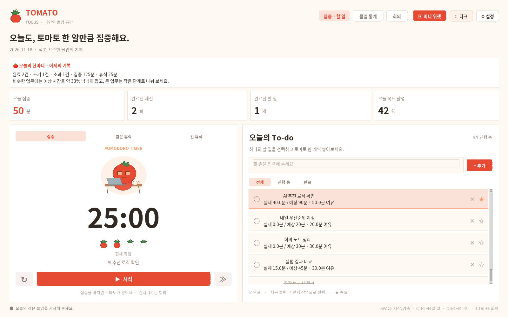
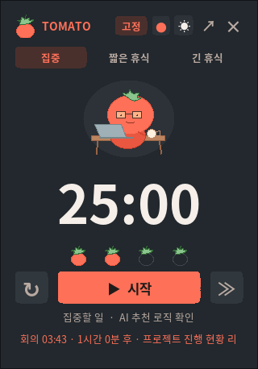

<div align="center">

<h1>🍅 Tomato Focus</h1>

<strong>오늘도, 토마토 한 알만큼 집중해요\.</strong><br><br>

Tkinter로 만든 가벼운 데스크톱 뽀모도로 타이머<br>
집중 시간 관리 · 업무별 시간 추적 · 예상 시간 추천 · 오늘의 한마디<br>
회의 알림 · 토마토 폭죽 · 주/월/연 몰입 통계 · 항상 위에 표시되는 미니 위젯

<strong>Python 3\.9\+</strong> · <strong>Tkinter</strong> · <strong>Windows EXE 배포 지원</strong> · <strong>Light / Dark</strong>

</div>

---

## 📸 미리보기

|☀️ 라이트 모드                                                                  |🌙 다크 모드                                                                 |
|:------------------------------------------------------------------------:|:----------------------------------------------------------------------:|
|||

|📌 미니 위젯 (다크 모드)                                                                     |📊 연간 통계                                                                           |
|:----------------------------------------------------------------------------------:|:--------------------------------------------------------------------------------:|
|||

> 스크린샷에는 기능 확인을 위해 만든 **예시 데이터**가 포함되어 있습니다. 기존 버전 화면이므로 최신 업무 추적·오늘의 한마디 UI와 일부 다를 수 있습니다. 실제 기록은 사용자 로컬 파일에서 불러옵니다.

## ✨ 주요 기능

### 🍅 뽀모도로 타이머

- **집중 / 짧은 휴식 / 긴 휴식** 3가지 모드
- 기본값: **집중 25분 · 짧은 휴식 10분 · 긴 휴식 30분**
- 집중 **4회 완료 시** 긴 휴식으로 전환 &#40;횟수 변경 가능&#41;
- 타이머 **시작, 일시정지, 초기화, 건너뛰기**
- 세션 완료 시 알림음&#40;Tkinter 벨&#41; 및 다음 휴식 모드 전환
- 옵션 활성화 시 **집중 세션 완료 후 휴식 자동 시작**
- 주·월·연 몰입 통계에는 완료한 집중 세션만 반영하며, 선택한 업무의 부분 집중 시간은 업무별 기록에 별도로 반영

### 🎉 토마토 폭죽 · 휴식 알림

- 집중 세션 완료 시 **토마토 수확 완료\!** 팝업과 알림음 표시
- 작은 토마토와 색종이가 터지는 2\.4초 Canvas 애니메이션
- 짧은 휴식과 긴 휴식을 구분하여 설정된 휴식 시간 안내
- 최상단 팝업에서 **휴식 시작** 또는 **닫기** 선택 &#40;자동 휴식이 실행 중이면 확인 버튼 표시&#41;
- 애니메이션 종료 후에도 직접 닫을 때까지 알림창 유지
- 라이트·다크 테마 적용, 외부 GIF 및 이미지 파일 불필요
- 애니메이션 종료 또는 창 닫기 시 예약 콜백 정리

### ✅ 오늘의 To\-do · 업무별 시간 추적

- 할 일 추가 / 완료 / 삭제, 중요 표시&#40;★&#41;, 전체·진행 중·완료 필터
- 업무명 입력 후 **카테고리와 예상 집중 시간&#40;분&#41;** 등록
- 할 일 제목을 클릭해 집중할 업무 선택 &#40;진행 중인 집중 세션에서는 업무 변경 제한&#41;
- 집중 시작 시 업무 ID를 세션에 연결하고 여러 세션의 실제 집중 시간을 누적
- 일시정지 및 휴식 시간은 업무별 실제 집중 시간에서 제외
- 선택한 업무를 세션 도중 완료하거나 초기화·건너뛰기·모드 변경·정상 종료하면 그때까지의 부분 집중 시간 저장
- 업무별 실제 시간, 예상 시간, 남은 여유 또는 초과 시간 표시
- 업무 완료 시 완료 날짜와 예상·실제 시간 기록 저장

|업무      |예상 |실제 |결과    |
|--------|--:|--:|------|
|모델 성능 분석|60분|45분|15분 단축|
|데이터 전처리 |30분|40분|10분 초과|
|리포트 작성  |90분|90분|예상과 일치|

> 위 표는 계산 예시입니다. 비교 대상은 업무의 전체 경과 시간이 아니라 타이머로 측정한 집중 시간입니다. 업무를 선택하지 않은 부분 집중 세션은 저장되지 않습니다. 진행 중인 세션의 시간은 기록 저장 시점에 반영됩니다.

### 🧠 유사 업무 기반 예상 소요 시간 추천

새로운 할 일을 등록하면 이전 완료 업무의 실제 집중 기록을 분석하여 예상 시간을 제안합니다\.

- 업무명 문자열 유사도&#40;`SequenceMatcher`&#41; 0\.65 이상 **또는** 동일한 비어 있지 않은 카테고리를 유사 업무로 분류
- 실제 집중 기록이 있는 완료 업무의 중앙값&#40;분&#41;을 추천값으로 사용
- 유사 업무 건수와 추천 시간을 예상 시간 입력창에 표시하며 사용자가 수정 가능
- 추천 기록이 없으면 25분을 초기값으로 제시
- 시간이 누적될수록 유사 업무의 개인별 소요 시간 추정에 활용 가능

> 외부 AI API나 머신러닝 학습 없이 로컬 기록을 사용하는 통계 기반 추천입니다. 과거 업무 제목 및 카테고리의 일관성이 중요하며, 난이도 차이는 자동 보정하지 않습니다. 삭제된 할 일은 추천 후보에서 제외됩니다.

### 💬 오늘의 한마디 · Daily Focus Coach

전날의 기록을 활용해 오늘의 업무 진행 전략을 제안합니다\.

- 완료 업무 수, 조기 완료 건수, 시간 초과 건수, 집중 시간, 휴식 시간 요약
- 예상·실제 시간이 모두 기록된 업무를 비교하고, 초과 업무의 비중이 높으면 초과 비율 중앙값을 바탕으로 추가 시간 권장 &#40;10\~100%&#41;
- 조기 완료가 많으면 유사 업무의 예상 시간 재조정 제안
- 완료 업무가 없으면 중요한 업무 하나부터 완료하도록 안내
- 실제 휴식 기록이 없거나 휴식/집중 비율이 15% 미만이면 휴식 타이머 사용 또는 충분한 휴식 권장
- 전날 기록이 없으면 핵심 업무 선택과 예상 시간 설정 안내
- 대시보드 생성 및 날짜 변경 후 화면 갱신 시 조언 재계산

실제 휴식 타이머를 실행한 시간을 기록하며, 완료하지 않은 휴식도 초기화·모드 변경·정상 종료 시 저장합니다\. 일시정지는 제외합니다\. 이전 버전에서 저장하지 않은 휴식 시간은 복원할 수 없으므로 기록 없음과 실제 휴식 부족을 구분하여 해석하세요\.

> 오늘의 한마디는 규칙 기반 조언이며 실제 집중력이나 건강 상태를 측정하지 않습니다. 업무 완료 분석은 전날 완료 기록을, 집중·휴식 분석은 전날 저장된 타이머 기록을 사용합니다. 업무 시간 초과는 마감일 지연을 의미하지 않습니다.

### 🔔 회의 일정 및 알림

- **회의** 탭에서 회의 제목, 날짜, 시작 시간 등록
- 회의별 **10분 전 / 15분 전** 알림 선택 &#40;기본값 10분&#41;
- 예정된 회의까지 남은 시간 확인 및 일정 수정·삭제
- 미니 위젯 하단에 다음 회의 표시, 클릭하여 회의 탭 열기
- 알림 시각이 되면 다른 일반 프로그램 위에 토마토 팝업과 Tkinter 알림음 표시
- 회의 알림이 떠도 진행 중인 뽀모도로 타이머는 계속 동작
- 알림 표시 여부와 회의 일정 자동 저장, 동일 회의의 중복 알림 방지
- 여러 회의의 알림 시간이 겹쳐도 각각 표시

> **알림 조건:** Tomato Focus가 실행 중이어야 합니다. 회의 확인 주기는 5초이므로 정상 상황에서 알림이 최대 약 5초 늦게 표시될 수 있습니다. 앱을 알림 시각 이후에 실행했더라도 회의 시작 전이면 알림을 표시합니다. 앱을 완전히 종료하거나 PC가 꺼져 있으면 알림이 울리지 않으며, 시작 시간이 지난 회의는 소급 알림하지 않습니다. PC의 로컬 날짜와 시간을 사용합니다. 외부 캘린더 연동이나 Windows 시스템 알림 센터 연동은 제공하지 않습니다.

### 📊 몰입 통계

|보기    |그래프 기준   |확인할 수 있는 내용              |
|------|---------|-------------------------|
|**주간**|월~일, 요일별 |이번 주 또는 선택한 주의 일별 집중 시간  |
|**월간**|날짜별      |날짜별 집중 분포 및 활동 지도        |
|**연간**|1~12월, 월별|월별 집중 시간과 연간 Activity Map|

기간별로 다음 지표를 제공합니다\.

- **누적 몰입 시간&#40;분&#41;**: 해당 기간에 *완료한* 집중 세션의 설정 시간&#40;분&#41; 합계
- **완료한 토마토&#40;개&#41;**: 완료 세션 수
- **몰입한 날&#40;일&#41;**: 집중 완료 기록이 있는 날짜 수
- **끊김 없는 집중&#40;%&#41;**: 일시정지 없이 완료한 세션의 비율
- **Activity Map**: 날짜별 집중 시간이 많을수록 짙어지는 토마토색 히트맵
- 기간 이동 버튼으로 **이전/다음 주·월·연** 비교

> **몰입도 계산 안내:** 이 버전의 ‘끊김 없는 집중’은 키보드·마우스 활동 추적이나 AI 기반 집중도 측정이 아닙니다. **일시정지 횟수(`pause_count`)가 0인 완료 세션 비율**을 나타냅니다. 과거 데이터에 일시정지 정보가 없으면 해당 비율 계산에서 제외합니다.

> **집계 기준 차이:** 업무별 실제 집중 시간과 오늘의 한마디는 저장된 부분 집중 기록도 활용합니다. 주·월·연 통계는 완료 세션만 집계하므로 두 수치가 다를 수 있습니다.

### 📌 항상 위에 표시되는 미니 위젯

- **미니 위젯 최상단 표시 기본 ON** &#40;`mini_always_on_top=True`&#41;
- 다른 일반 프로그램 위에 타이머를 띄운 채 작업 가능
- 미니 창의 상단 바를 드래그해 위치 이동
- **고정/해제** 버튼으로 항상 위에 표시 설정 변경
- 미니 창 **↗** 버튼으로 메인 대시보드 복귀
- 미니 위젯 위치 및 고정 설정 자동 저장
- 메인 대시보드의 최상단 표시 여부는 **별도로 설정** &#40;기본 OFF&#41;

> Windows의 일부 독점 전체 화면 앱, 보안 데스크톱, 시스템 권한 창 등에서는 OS의 창 우선순위 정책 때문에 최상단 표시가 보장되지 않을 수 있습니다.

### 🛡️ 장시간 실행 · 안정성 · 메모리 최적화

- 일반 실행에는 자동 종료 시간이 없으며, 타이머나 회의 일정이 끝나도 프로그램은 계속 실행됩니다\.
- 창의 **×** 또는 `Ctrl + Q`로 종료 요청 시 확인 창이 표시됩니다\. 취소하면 타이머와 회의 알림은 유지됩니다\.
- Windows에서는 \*\*설정 → 실행 중 PC 자동 절전 방지 &#40;Windows&#41;\*\*가 기본 ON입니다\. Windows의 유휴 절전만 방지하며, 모니터 꺼짐/화면 잠금은 막지 않습니다\. 배터리 사용 시 설정에서 끌 수 있습니다\.
- 자동 절전 방지가 수동 절전, 덮개 닫기, 시스템 종료, 강제 종료, OS 정책 또는 시스템 오류까지 막지는 못합니다\.
- 타이머는 실행 중 약 250ms, 대기 중 5초마다 확인하며, 회의 일정은 5초마다 확인합니다\. 타이머는 단조 시계의 종료 시각을 기준으로 계산합니다\.
- 통계는 날짜별 집계와 현재 기간 캐시를 사용하고, 변경되지 않은 버튼·할 일·회의 요약은 다시 그리지 않습니다\. 완료 기록은 삭제하거나 요약본으로 대체하지 않습니다\.
- 주기적 콜백에서 오류가 발생해도 다시 실행되도록 예약하고, 종료 시 예약된 콜백을 취소합니다\.
- 오류 진단용 로그: `~/.focus_studio/tomato_focus.log` &#40;최대 약 512KB, 회전 백업 포함&#41;\. 비정상적으로 닫히는 현상이 재발하면 로그와 Windows 이벤트 뷰어를 확인하세요\.

### 🌓 라이트 / 다크 테마

- 화이트·코랄 컬러의 **라이트 모드**와 차콜·토마토 레드 컬러의 **다크 모드**
- 대시보드 및 미니 위젯의 ☀/☾ 버튼으로 즉시 전환
- **설정 → 화면 테마**에서도 선택 가능
- 타이머, To\-do, 통계, 회의 탭 및 새로 표시되는 회의·휴식 알림에 적용
- 마지막으로 선택한 테마를 저장하고 다음 실행 시 복원

---

## 🚀 설치 및 실행

### 요구 사항

- **Python 3\.9 이상**
- Python 표준 라이브러리의 **Tkinter** &#40;일반적인 Windows Python 설치에 포함&#41;
- 별도 외부 UI 라이브러리 또는 이미지 파일 불필요

> Linux 환경에서는 배포판에 따라 `python3-tk` 패키지를 별도로 설치해야 할 수 있습니다. Windows용 EXE는 Windows에서 빌드하세요.

### Python으로 실행

프로젝트 폴더에서 다음 명령어를 실행합니다\.

```bash
python focus_studio_tomato.py
```

미니 위젯으로 바로 시작하려면:

```bash
python focus_studio_tomato.py --mini
```

기능 확인용 샘플 데이터로 실행하려면:

```bash
python focus_studio_tomato.py --demo
```

`--demo`는 예시 할 일과 집중 기록을 메모리에 표시하며, 해당 실행에서 데이터 파일을 저장하지 않습니다\.

### 🪟 Windows EXE 빌드 &#40;PyInstaller&#41;

**1\. PyInstaller 설치**

```bash
python -m pip install pyinstaller
```

**2\. 실행 파일 생성**

```bash
python -m PyInstaller --noconfirm --clean --onefile --windowed --name TomatoFocus focus_studio_tomato.py
```

**3\. 실행**

```powershell
.\dist\TomatoFocus.exe
```

미니 위젯으로 바로 실행하려면:

```powershell
.\dist\TomatoFocus.exe --mini
```

생성 파일은 `dist/TomatoFocus.exe`에 있습니다\. `--windowed`는 콘솔 창을 숨기고, `--onefile`은 실행 파일 하나로 패키징합니다\. 일반적인 실행에는 별도 그림 파일이나 데이터 파일을 EXE에 포함할 필요가 없습니다\.

> **빌드 환경:** Windows용 `.exe`는 Windows에서 PyInstaller를 실행해 빌드해야 합니다. 실제 Windows EXE 빌드·실행 검증은 별도로 진행하는 것을 권장합니다.

---

## 🕹️ 사용 방법

1. **오늘의 한마디**에서 전날 성과와 오늘의 권장 전략을 확인합니다\.
2. **집중 · 할 일** 화면에서 업무명과 카테고리를 등록합니다\.
3. 유사 업무 추천값을 참고하여 예상 집중 시간을 입력합니다\.
4. 할 일 제목을 클릭해 집중할 업무를 선택하고 **▶ 시작**을 누릅니다\.
5. 집중 완료 시 토마토 폭죽 알림을 확인하고 휴식을 진행합니다\.
6. 업무가 끝나면 완료 체크를 누르고 예상 시간 대비 단축·초과 시간을 확인합니다\.
7. **몰입 통계**에서 주간·월간·연간 기록을 확인합니다\.
8. **회의** 탭에서 회의 일시와 알림 시점을 등록합니다\.
9. 다른 프로그램을 사용할 때는 **미니 위젯**으로 전환합니다\.

### 단축키

|단축키       |동작                         |
|----------|---------------------------|
|`Space`   |타이머 시작 / 일시정지 (텍스트 입력 중 제외)|
|`Ctrl + N`|할 일 입력으로 이동 (필요 시 메인 화면 열기)|
|`Ctrl + M`|미니 위젯 / 메인 화면 전환           |
|`Ctrl + E`|회의 일정 화면 열기                |
|`Ctrl + Q`|종료 확인 창 열기                 |
|`Esc`     |미니 위젯에서 메인 화면으로 복귀         |

### 설정 기본값

|항목              |기본값         |
|----------------|------------|
|집중 시간           |25분         |
|짧은 휴식           |10분         |
|긴 휴식            |30분         |
|긴 휴식 간격         |집중 4회       |
|하루 집중 목표        |120분        |
|미니 위젯 항상 위      |켜짐          |
|메인 화면 항상 위      |꺼짐          |
|휴식 자동 시작        |꺼짐          |
|실행 중 PC 자동 절전 방지|켜짐 (Windows)|
|화면 테마           |라이트         |

시간 값은 설정에서 변경할 수 있습니다\. 현재 코드는 각 시간과 목표를 **1\~999분**, 긴 휴식 간격을 **1\~20회**로 제한합니다\.

---

## 💾 데이터 저장 · 백업

할 일, 업무별 예상 시간과 실제 집중 기록, 완료 세션, 부분 집중 기록, 실제 휴식 기록, 업무 완료 이력, 회의 일정 및 알림 상태, 테마, 설정 및 미니 위젯 위치는 **로컬 JSON 파일**에 저장됩니다\.

```text
~/.focus_studio/state.json
```

Windows의 일반적인 위치:

```text
C:\Users\<사용자명>\.focus_studio\state.json
```

|저장 항목                |주요 필드                                            |
|---------------------|-------------------------------------------------|
|`tasks`              |업무 ID, 제목, 카테고리, 예상 시간, 완료 날짜                    |
|`sessions`           |업무 ID, 집중 시간(초), 완료 여부(`partial`), 일시정지 횟수(완료 세션)|
|`breaks`             |날짜, 실제 휴식 시간(초), 휴식 모드                           |
|`task_completion_log`|완료 날짜, 업무 ID, 예상 시간(분), 실제 집중 시간(초)              |

- **클라우드 계정이나 서버 없이 로컬 저장**합니다\.
- 기존 Focus Studio의 `state.json`과 데이터 형식을 호환하도록 작성했습니다\.
- 이전 버전에서 업그레이드하기 전에는 `state.json`을 다른 곳에 **백업**하는 것을 권장합니다\.
- 현재 진행 중인 **미완료 타이머의 남은 시간은 재실행 시 복구되지 않습니다\.** 완료한 집중 세션 및 할 일 기록은 저장되며, 정상 종료 시 선택한 업무의 부분 집중 시간과 진행 중인 휴식 시간도 저장합니다\. 강제 종료 시에는 마지막 저장 이후 기록이 유실될 수 있습니다\.
- 데이터 파일을 삭제하면 저장된 기록이 사라지므로 주의하세요\.

## 📁 프로젝트 구조

```text
TomatoFocus/
├── README.md
├── focus_studio_tomato.py
└── docs/
    └── screenshots/
        ├── focus-light.png
        ├── focus-dark.png
        ├── mini-widget-dark.png
        └── statistics-year.png
```

코드 실행에 필수인 파일은 `focus_studio_tomato.py` 하나입니다\. `docs/screenshots`는 GitHub README에 이미지를 보여주기 위한 폴더입니다\.

## 🔧 자주 묻는 질문

**Q\. 미니 위젯이 다른 프로그램 뒤로 가요\.**<br>
미니 위젯 상단 **고정** 버튼이 켜져 있는지 확인하세요\. 메인 화면은 **설정 → 메인 대시보드도 항상 위에 표시**를 별도로 켜야 합니다\. 일부 전체 화면 앱에서는 OS 정책으로 최상단 표시가 제한됩니다\.

**Q\. 실행 파일을 다시 빌드하면 기록이 사라지나요?**<br>
보통 사라지지 않습니다\. 기록은 EXE 파일이 아닌 사용자 홈의 `.focus_studio/state.json`에 저장됩니다\. 중요한 데이터는 업데이트 전에 백업하세요\.

**Q\. 통계 시간이 실제 PC 사용 시간과 다르게 나와요\.**<br>
이 프로그램의 집중 통계는 PC 활동을 감시하지 않고, **완료한 뽀모도로 세션**을 합산합니다\. 중간에 건너뛰거나 종료한 세션의 시간은 주·월·연 통계에 포함되지 않지만, 선택한 업무의 실제 집중 시간에는 저장될 수 있습니다\. 오늘의 한마디도 저장된 부분 집중 시간을 포함합니다\.

**Q\. 프로그램을 종료해도 회의 알림을 받을 수 있나요?**<br>
아니요\. 회의 알림은 프로그램이 실행 중일 때만 동작합니다\. 미니 위젯으로 실행해 둔 상태에서는 알림을 받을 수 있습니다\. 알림 시간이 지났지만 회의 시작 전이라면 재실행 시 표시합니다\.

**Q\. 일정 시간이 지나면 프로그램이 사라지거나 종료돼요\.**<br>
자동 종료는 설정되어 있지 않습니다\. 새 버전에서는 종료 확인, Windows 유휴 절전 방지, 콜백 오류 복구 및 진단 로그를 추가했습니다\. 문제가 재발하면 `tomato_focus.log`의 마지막 기록을 확인하세요\. OS가 프로세스를 강제 종료한 경우에는 로그가 남지 않을 수도 있습니다\. Linux Tkinter 환경에서 기능 및 반복 화면 전환 테스트를 진행했으며 Windows EXE의 장시간 동작은 별도로 검증해야 합니다\.

**Q\. 업무를 타이머 종료 전에 완료하면 어떻게 되나요?**<br>
해당 업무가 현재 집중 세션에 연결되어 있으면 그때까지의 실제 집중 시간을 저장하고 타이머를 초기화합니다\. 여러 세션의 누적 시간을 예상 시간과 비교합니다\.

**Q\. 예상 시간 추천이 나오지 않아요\.**<br>
실제 집중 기록이 있는 유사 완료 업무가 필요합니다\. 업무명과 카테고리를 일관되게 등록하고 완료 기록을 쌓아 주세요\.

**Q\. 오늘의 한마디에서 휴식 기록이 없다고 나와요\.**<br>
휴식 타이머를 실제 실행해야 기록됩니다\. 이전 버전의 휴식 데이터나 타이머 밖에서 쉰 시간은 자동 추정하지 않습니다\.

**Q\. 외부 패키지를 설치해야 하나요?**<br>
일반적인 Python 실행에는 필요하지 않습니다\. **EXE 빌드에만 PyInstaller** 설치가 필요합니다\.

---

<div align="center">

**작고 꾸준한 몰입, Tomato Focus 🍅**

</div>
